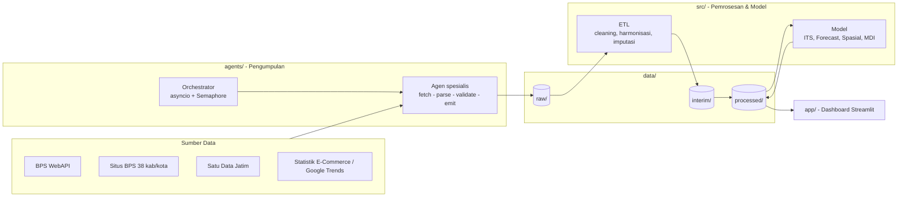
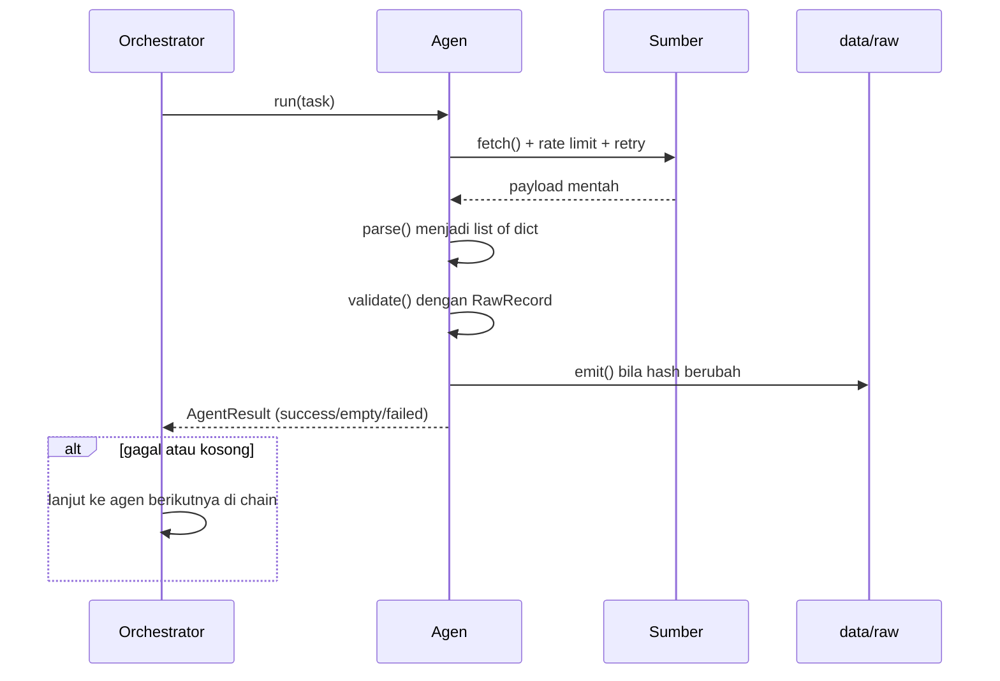

<div align="center">

# 🏪 EWS Pasar Tradisional Jawa Timur

**Early Warning System Risiko Kebangkrutan & Penyusutan Pembeli Pasar Tradisional**
**38 Kabupaten/Kota · Provinsi Jawa Timur · 2014–2024**

[](https://github.com/dawooodd/analisis-tren-pasartradisional/actions/workflows/ci.yml)


</div>

---

Repositori ini membangun sistem analitik berbasis data untuk **memetakan pasar tradisional yang rawan mati** di Jawa Timur. Sistem ini mengumpulkan indikator dari 38 situs BPS kabupaten/kota dan portal data pemerintah secara asinkron, mengukur dampak guncangan COVID-19 serta disrupsi e-commerce, menghitung **Market Distress Index (MDI)**, lalu menyajikannya dalam dashboard Streamlit interaktif.

> [!NOTE]
> Proyek sedang berada pada **fase arsitektur**. Kerangka agen, orchestrator, kontrak data, konfigurasi, dan dashboard sudah berjalan. Implementasi pengambilan data, ETL, dan pemodelan masih berupa *stub* (`NotImplementedError`). Lihat [Status & Roadmap](#-status--roadmap).

## 📑 Daftar Isi

- [Latar Belakang](#-latar-belakang)
- [Tujuan & Pertanyaan Riset](#-tujuan--pertanyaan-riset)
- [Arsitektur Sistem](#-arsitektur-sistem)
- [Struktur Repositori](#-struktur-repositori)
- [Instalasi](#-instalasi)
- [Konfigurasi](#-konfigurasi)
- [Penggunaan](#-penggunaan)
- [Kontrak Data](#-kontrak-data)
- [Sistem Multi-Agen](#-sistem-multi-agen)
- [Metodologi Analisis](#-metodologi-analisis)
- [Dashboard](#-dashboard)
- [Pengujian & Kualitas Kode](#-pengujian--kualitas-kode)
- [Sumber Data & Etika](#-sumber-data--etika)
- [Keterbatasan](#-keterbatasan)
- [Status & Roadmap](#-status--roadmap)
- [Kontribusi](#-kontribusi)
- [Lisensi](#-lisensi)

---

## 📖 Latar Belakang

Dalam satu dekade terakhir, pasar rakyat di Jawa Timur menghadapi tekanan dari tiga arah:

| Periode | Tekanan | Dampak terhadap pasar tradisional |
|---------|---------|-----------------------------------|
| 2014–2019 | Ekspansi minimarket berjaringan & pembayaran digital | Erosi bertahap basis pembeli, terutama di perkotaan |
| 2020–2021 | Pandemi COVID-19 (PSBB/PPKM) | Pembatasan operasional, penutupan sementara, anjloknya daya beli |
| 2022–2024 | *Live commerce* & *social commerce* | Kompetisi harga lintas wilayah pada komoditas non-pangan |

Masalah utamanya adalah **belum ada sistem peringatan dini yang terpusat**. Data pasar tersebar di puluhan situs dengan format dan definisi yang berbeda, sehingga intervensi pemerintah cenderung reaktif. Narasi lengkap tersedia di [`docs/SPESIFIKASI_TEKNIS.md`](docs/SPESIFIKASI_TEKNIS.md).

## 🎯 Tujuan & Pertanyaan Riset

**Output yang ditargetkan:**

1. **Panel data terpadu** 38 kab/kota × 11 tahun yang tervalidasi dan memiliki jejak asal data (*lineage*).
2. **Kuantifikasi guncangan COVID-19**: besaran penurunan (*shock magnitude*) dan *recovery rate* per wilayah.
3. **Market Distress Index (MDI)** 0–100 dengan klasifikasi zona 🟢 Hijau · 🟡 Kuning · 🟠 Oranye · 🔴 Merah.
4. **Peta zona merah** berbasis klaster spasial (LISA).
5. **Proyeksi 2025–2029** dengan *prediction interval* dan tiga skenario kebijakan.
6. **Dashboard Streamlit** yang diperbarui otomatis.

**Hipotesis utama:**

| Kode | Hipotesis |
|------|-----------|
| **H1** | *Paradoks pertumbuhan*: wilayah dengan pertumbuhan PDRB perdagangan tertinggi justru mengalami penyusutan pasar tradisional tercepat. |
| **H2** | *Scarring*: COVID-19 menciptakan penurunan permanen; wilayah perkotaan belum pulih penuh hingga 2024, sementara kabupaten agraris pulih lebih cepat. |
| **H3** | *Kontagion spasial*: distress pasar terklaster secara geografis dan merambat dari pusat ritel modern ke wilayah tetangganya. |

---

## 🏗 Arsitektur Sistem



**Prinsip desain:**

| Prinsip | Implementasi |
|---------|--------------|
| **Utamakan API, scraping sebagai cadangan** | Setiap indikator punya urutan sumber; orchestrator berpindah ke sumber berikutnya bila sumber utama gagal. |
| **Isolasi kegagalan** | Kegagalan satu wilayah atau indikator tidak menghentikan pipeline; semuanya tercatat di manifest. |
| **Raw data immutable** | Payload asli disimpan apa adanya beserta hash SHA-256; penulisan dilewati bila isi tidak berubah. |
| **Konfigurasi terpusat** | Tidak ada konstanta *hardcode*; seluruh parameter ada di `config/` dan diakses lewat `src/utils/io.py`. |
| **Kontrak data eksplisit** | Validasi berlapis: Pydantic per baris (agen) dan Pandera per tabel (ETL). |
| **Akses yang sopan** | Pembatasan laju per host, *backoff* eksponensial, User-Agent identifikatif, patuh `robots.txt`. |

---

## 📂 Struktur Repositori

```text
analisis-tren-pasartradisional/
├── .github/workflows/ci.yml        # CI: ruff + pytest
├── .streamlit/config.toml          # Tema dashboard
├── agents/                         # Lapisan pengumpulan data
│   ├── base_agent.py               #   Kelas abstrak & siklus hidup agen
│   ├── orchestrator.py             #   Penjadwal asinkron + CLI
│   ├── bps_api_agent.py            #   Sumber utama: BPS WebAPI
│   ├── bps_html_agent.py           #   Cadangan: scraping tabel BPS
│   ├── satudata_agent.py           #   Portal Satu Data Jatim
│   ├── ecommerce_agent.py          #   Indikator disrupsi digital
│   ├── registry/wilayah_jatim.yaml #   38 kab/kota: kode BPS & subdomain
│   └── utils/                      #   rate limiter, retry, header HTTP
├── app/                            # Dashboard Streamlit
│   ├── Home.py                     #   Entry point
│   ├── pages/                      #   5 halaman analitik
│   ├── components/                 #   sidebar, chart, akses data, layout
│   └── assets/style.css            #   Design tokens
├── config/
│   ├── settings.yaml               # Parameter global
│   ├── indicators.yaml             # Kamus indikator kanonik
│   └── logging.yaml
├── docs/SPESIFIKASI_TEKNIS.md      # Spesifikasi bisnis & teknis lengkap
├── src/                            # Lapisan pemrosesan & pemodelan
│   ├── ingestion/                  #   schema (kontrak data) & loader
│   ├── processing/                 #   cleaning, harmonisasi, imputasi, fitur
│   ├── models/                     #   ITS, forecasting, spasial, survival, MDI
│   ├── evaluation/                 #   metrik & backtesting
│   ├── pipeline/                   #   run_etl.py, run_models.py
│   └── utils/                      #   io (config & path), geo
├── tests/                          # Unit test (tanpa akses jaringan)
├── .env.example
├── Makefile
├── pyproject.toml
└── requirements.txt
```

Direktori berikut **dibuat otomatis saat runtime** dan tidak di-commit:

| Direktori | Dibuat oleh | Isi |
|-----------|-------------|-----|
| `data/raw/` | Agen (`emit`) | Payload mentah, record JSONL, metadata hash |
| `data/interim/`, `data/processed/` | Pipeline ETL & model | Panel Parquet, skor risiko, hasil forecast |
| `data/external/geo/` | Manual | `jatim_kabkota.geojson` (satu-satunya isi `data/` yang di-commit) |
| `logs/` | `setup_logging()` | `pipeline.log`, `run_manifest_*.json` |
| `notebooks/`, `reports/figures/` | Fase analisis | Eksperimen & figur |

---

## ⚙ Instalasi

### Prasyarat

- Python **3.10+**
- Git
- API key **BPS WebAPI**, gratis melalui registrasi di [webapi.bps.go.id](https://webapi.bps.go.id/developer/)
- *(Opsional)* GNU Make. Di Windows bisa diganti perintah setara (lihat [Penggunaan](#-penggunaan)).

### Langkah

**1. Clone repositori**

```bash
git clone https://github.com/dawooodd/analisis-tren-pasartradisional.git
cd analisis-tren-pasartradisional
```

**2. Buat virtual environment & install**

<details open>
<summary><b>Windows (PowerShell)</b></summary>

```powershell
python -m venv .venv
.\.venv\Scripts\Activate.ps1
python -m pip install --upgrade pip
pip install -e ".[dev]"
```

</details>

<details>
<summary><b>Linux / macOS</b></summary>

```bash
python3 -m venv .venv
source .venv/bin/activate
python -m pip install --upgrade pip
pip install -e ".[dev]"
```

</details>

`pip install -e` memasang paket `agents` dan `src` dalam mode *editable* sehingga keduanya dapat diimpor dari notebook, dashboard, dan test.

**3. Siapkan variabel lingkungan**

```bash
cp .env.example .env        # Windows: Copy-Item .env.example .env
```

Isi `.env`:

```dotenv
BPS_API_KEY=isi_api_key_anda
ENV=development
LOG_LEVEL=INFO
```

**4. *(Opsional)* Browser untuk agen scraping & pre-commit hook**

```bash
playwright install chromium   # hanya bila BpsHtmlAgent memerlukan rendering JavaScript
pre-commit install
```

**5. Verifikasi**

```bash
pytest -q
python -m agents.orchestrator --dry-run
```

> [!TIP]
> Dependensi pemodelan (`prophet`, `geopandas`, `mgwr`) cukup berat. Bila instalasi `prophet` gagal di Windows, pasang terlebih dahulu dengan `pip install prophet --only-binary=:all:` atau gunakan Conda.

---

## 🔧 Konfigurasi

Seluruh perilaku sistem dikendalikan dari tiga file YAML. Perubahan tidak memerlukan modifikasi kode.

### `config/settings.yaml`

| Kunci | Default | Keterangan |
|-------|---------|------------|
| `project.tahun_mulai` / `tahun_akhir` | `2014` / `2024` | Rentang tahun analisis |
| `project.periode_covid` | `[2020, 2021]` | Periode intervensi untuk model ITS |
| `project.horizon_proyeksi` | `5` | Horizon forecast (tahun) |
| `agents.max_concurrency` | `6` | Batas task yang berjalan simultan |
| `agents.rate_limit_per_s` | `2.0` | Maksimum permintaan per detik **per host** |
| `agents.request_timeout_s` | `30` | Timeout per permintaan HTTP |
| `agents.retry.*` | `4`, `1s`, `30s` | Jumlah percobaan & rentang *backoff* |
| `agents.user_agent` | — | **Ganti email kontak** sebelum menjalankan agen |
| `sources.<nama>.enabled` | — | Aktif/nonaktifkan sumber data |
| `risk_index.thresholds` | 25/50/75/100 | Batas zona MDI |

### `config/indicators.yaml`

Kamus indikator kanonik. Setiap entri:

```yaml
- kode: jml_pasar_tradisional     # ID internal, dipakai di seluruh pipeline
  nama: Jumlah pasar tradisional
  satuan: unit
  kelompok: infrastruktur         # infrastruktur | aktivitas | makro | kompetitor | digital | demografi
  sumber: [bps_api, bps_html]     # urutan = prioritas (sumber pertama, lalu cadangan)
  bps_var_id: null                # ID variabel BPS (diisi saat implementasi agen)
  arah_risiko: -1                 # +1 naik = makin berisiko, -1 naik = makin aman, 0 netral
```

Menambah indikator cukup dengan menambah entri. Orchestrator otomatis menjadwalkannya untuk 38 wilayah.

### `agents/registry/wilayah_jatim.yaml`

Daftar 38 kab/kota (29 kabupaten, 9 kota) dengan `kode` BPS 4 digit (`3501`–`3529`, `3571`–`3579`) yang sekaligus menjadi kunci join ke GeoJSON dan parameter `domain` BPS WebAPI.

---

## 🚀 Penggunaan

### Perintah utama

| Tahap | Make | Perintah setara (Windows tanpa Make) |
|-------|------|--------------------------------------|
| Install | `make install` | `pip install -e ".[dev]"` lalu `pre-commit install` |
| Kumpulkan data | `make scrape` | `python -m agents.orchestrator` |
| ETL | `make etl` | `python -m src.pipeline.run_etl` |
| Pemodelan | `make model` | `python -m src.pipeline.run_models` |
| Dashboard | `make app` | `streamlit run app/Home.py` |
| Test | `make test` | `pytest -q` |
| Lint | `make lint` | `ruff check .` lalu `mypy agents src` |

### CLI Orchestrator

```bash
# Lihat rencana eksekusi tanpa mengakses jaringan
python -m agents.orchestrator --dry-run

# Semua wilayah & indikator
python -m agents.orchestrator

# Subset wilayah (Kota Surabaya & Kota Malang)
python -m agents.orchestrator --wilayah 3578 3573

# Subset indikator
python -m agents.orchestrator --indikator jml_penduduk pdrb_g_adhk
```

Contoh keluaran `--dry-run`:

```text
INFO | agents.orchestrator | Indikator jml_pedagang_aktif dilewati: tidak ada sumber aktif
INFO | agents.orchestrator | Rencana: 266 task
INFO | agents.orchestrator |   3501:jml_pasar_tradisional:2014-2024  via bps_api -> bps_html
...
```

Setiap eksekusi menghasilkan manifest di `logs/run_manifest_<timestamp>.json`:

```json
{
  "timestamp": "20261012_003610",
  "total": 266,
  "status": {"success": 240, "empty": 6, "failed": 20},
  "results": [
    {"key": "3578:jml_penduduk:2014-2024", "agent": "bps_api", "status": "success",
     "n_records": 11, "n_invalid": 0, "error": null, "durasi_s": 1.204,
     "raw_path": "data/raw/bps_api/3578/jml_penduduk_2014_2024.meta.json"}
  ]
}
```

*(Angka status di atas hanya ilustrasi.)*

---

## 📐 Kontrak Data

### Format kanonik: *long format*

Seluruh data mengalir dalam format panjang, satu baris per **wilayah × tahun × indikator**. Format ini dipilih agar penambahan indikator baru tidak mengubah skema.

| Kolom | Tipe | Keterangan |
|-------|------|------------|
| `kode_wilayah` | `str` | Kode BPS 4 digit, wajib cocok dengan pola `^35\d{2}$` |
| `tahun` | `int` | Tahun observasi |
| `indikator` | `str` | Kode dari `indicators.yaml` |
| `nilai` | `float \| null` | Nilai observasi; `NaN` dinormalisasi menjadi `null` |
| `satuan` | `str` | Satuan |
| `sumber` | `str` | Nama agen asal data |
| `url_sumber` | `str` | URL asal (audit) |
| `diambil_pada` | `datetime` | Waktu pengambilan (UTC) |
| `is_imputed` | `bool` | `true` bila nilai hasil imputasi |

Didefinisikan di [`src/ingestion/schemas.py`](src/ingestion/schemas.py): `RawRecord` (Pydantic) dan `panel_schema()` (Pandera; unik pada `kode_wilayah`, `tahun`, `indikator`).

### Layout data mentah

```text
data/raw/{agen}/{kode_wilayah}/
├── {indikator}_{tahun_mulai}_{tahun_akhir}.json            # payload asli (json/html/csv)
├── {indikator}_{tahun_mulai}_{tahun_akhir}.records.jsonl   # record tervalidasi
└── {indikator}_{tahun_mulai}_{tahun_akhir}.meta.json       # url, sha256, n_records
```

---

## 🤖 Sistem Multi-Agen

### Siklus hidup agen



| Status | Arti |
|--------|------|
| `success` | Minimal satu record valid berhasil disimpan |
| `empty` | Sumber terjangkau tetapi tidak ada record valid, sehingga dicoba sumber cadangan |
| `failed` | Exception (jaringan, parsing, belum diimplementasikan), sehingga dicoba sumber cadangan |

### Kebijakan retry

Hanya error sementara yang di-retry: timeout, koneksi terputus, HTTP `429`, `500`, `502`, `503`, `504`. Error `4xx` lainnya langsung gagal agar tidak membuang kuota API.

### Menambah agen baru

```python
# agents/contoh_agent.py
from typing import Any
from agents.base_agent import AgentTask, BaseAgent, FetchResult


class ContohAgent(BaseAgent):
    name = "contoh"  # harus sama dengan key di settings.yaml > sources

    async def fetch(self, task: AgentTask) -> FetchResult:
        url = f"https://contoh.go.id/api?wilayah={task.wilayah.kode}"
        resp = await self._get(url)  # sudah termasuk rate limit + retry
        return FetchResult(resp.content, url, resp.headers.get("content-type", ""))

    def parse(self, payload: FetchResult, task: AgentTask) -> list[dict[str, Any]]:
        data = ...  # ubah payload menjadi list of dict
        return [
            {"kode_wilayah": task.wilayah.kode, "tahun": row["tahun"],
             "indikator": task.indikator, "nilai": row["nilai"], "url_sumber": payload.url}
            for row in data
        ]
```

Lalu:

1. Daftarkan kelas di `DEFAULT_AGENTS` pada [`agents/orchestrator.py`](agents/orchestrator.py).
2. Tambahkan `sources.contoh` di `settings.yaml`.
3. Cantumkan `contoh` pada `sumber` indikator terkait di `indicators.yaml`.

---

## 🔬 Metodologi Analisis

> [!IMPORTANT]
> Data tahunan 2014–2024 hanya memberi **11 observasi per wilayah**, terlalu pendek untuk model time-series univariat. Karena itu pemodelan memanfaatkan **struktur panel** (38 × 11 = 418 observasi) dan data bulanan bila tersedia.

### 1. Dampak COVID-19: Interrupted Time Series (panel)

$$
Y_{it} = \beta_0 + \beta_1 t + \beta_2\,\text{COVID}_t + \beta_3 (t - 2020)\,\text{POST}_t + \alpha_i + \varepsilon_{it}
$$

- $\beta_2$ adalah *level shift* (besaran anjlokan); $\beta_3$ adalah perubahan kemiringan pasca-intervensi.
- Fixed effects per wilayah ($\alpha_i$) dengan *clustered standard errors*.
- **Recovery Rate**:

$$
RR_i = \frac{Y_{i,2024} - Y_{i,\text{trough}}}{\hat{Y}_{i,2024 \mid \text{tren pra-COVID}} - Y_{i,\text{trough}}}
$$

  $RR \geq 1$ berarti pulih penuh; $RR < 0{,}5$ berarti *scarring* permanen.

### 2. Forecasting 2025–2029

| Model | Peran |
|-------|-------|
| SARIMAX | Baseline statistik dengan variabel eksogen & dummy intervensi |
| Prophet | Seri bulanan; *changepoint* manual 2020-03 dan 2022-01 |
| Global pooled model | Satu model untuk 38 wilayah, mengatasi seri pendek |
| Ensemble | Rata-rata tertimbang inverse-MASE |

Validasi dengan **rolling-origin backtesting**: origin 2019 diuji pada 2020–2021 (ketahanan terhadap guncangan), dan origin 2021 diuji pada 2022–2024 (kemampuan menangkap pemulihan). Metrik: **MASE** (utama), sMAPE, dan *interval coverage*.

### 3. Analisis Spasial

- **Global Moran's I** (*Queen contiguity*) menguji apakah penyusutan terklaster.
- **LISA** memetakan klaster High-High (zona merah) dan outlier spasial.
- **(M)GWR** mengukur apakah pengaruh e-commerce dan ritel modern berbeda antarkawasan.

### 4. Market Distress Index (MDI)

Indeks komposit 0–100 dari komponen ternormalisasi (bobot via PCA, divalidasi *expert judgment*):

| Komponen | Arah risiko |
|----------|:-----------:|
| Pertumbuhan jumlah pedagang aktif | ↓ |
| Tingkat kekosongan kios | ↑ |
| Pertumbuhan retribusi riil | ↓ |
| Minimarket per 10.000 penduduk | ↑ |
| Recovery rate pasca-COVID | ↓ |
| Persentase rumah tangga mengakses internet | ↑ |

| Zona | Skor |
|------|------|
| 🟢 Hijau | 0–25 |
| 🟡 Kuning | 26–50 |
| 🟠 Oranye | 51–75 |
| 🔴 Merah | 76–100 |

Detail lengkap ada di [`docs/SPESIFIKASI_TEKNIS.md`](docs/SPESIFIKASI_TEKNIS.md#33-metode-analisis--pemodelan).

---

## 📊 Dashboard

```bash
streamlit run app/Home.py
```

Buka `http://localhost:8501`. Jalankan perintah ini dari **root proyek** agar `.streamlit/config.toml` terbaca.

| Halaman | Isi |
|---------|-----|
| **Home** | KPI ringkasan: pasar aktif, pedagang aktif, rata-rata MDI, jumlah zona merah |
| **1 · Peta Risiko** | Choropleth 38 kab/kota dengan animasi tahun dan overlay klaster LISA |
| **2 · Tren Time-Series** | Tren indikator per wilayah, indexed chart (2014 = 100) |
| **3 · Dampak COVID** | Kuadran *shock magnitude* vs. *recovery rate* (Resilient/Recovered/Fragile/Scarred) |
| **4 · E-Commerce vs Pasar** | Dual-axis lapak fisik vs. penetrasi digital, shading PSBB/PPKM, garis kontrafaktual |
| **5 · Proyeksi 2029** | Fan chart PI 80%/95% dan ranking 10 wilayah berisiko tertinggi |

**Filter global (sidebar):** periode cepat (Pra-COVID/COVID/Pasca-COVID), rentang tahun, jenis wilayah, kab/kota, metrik, mode YoY, dan skenario proyeksi.

Bila data belum tersedia, dashboard menampilkan petunjuk untuk menjalankan pipeline terlebih dahulu.

---

## 🧪 Pengujian & Kualitas Kode

```bash
pytest -q                 # unit test
ruff check .              # lint
ruff format .             # format
mypy agents src           # type-check
pre-commit run --all-files
```

| Test | Cakupan |
|------|---------|
| `tests/test_registry.py` | 38 wilayah (29 kab + 9 kota), kode & subdomain unik, konsistensi indikator dengan sumber |
| `tests/test_agents.py` | Siklus agen, pembuangan record invalid, isolasi kegagalan, *fallback chain*, filter perencanaan |

Seluruh test berjalan **tanpa akses jaringan** menggunakan agen palsu. CI (GitHub Actions) menjalankan lint dan test pada setiap push ke `main` dan pull request.

Pre-commit hook mencakup `ruff`, `ruff-format`, `nbstripout` (membersihkan output notebook), validasi YAML, dan penolakan file > 2 MB.

---

## 🗂 Sumber Data & Etika

| Sumber | Indikator | Akses |
|--------|-----------|-------|
| [BPS WebAPI](https://webapi.bps.go.id/developer/) | PDRB, penduduk, akses internet | API resmi (API key) |
| Situs BPS kab/kota (`{wilayah}kab/kota.bps.go.id`) | Jumlah pasar, minimarket (Kab/Kota Dalam Angka) | Tabel publik |
| Satu Data Jawa Timur | Pedagang aktif, retribusi pasar | Portal data terbuka *(nonaktif hingga diverifikasi)* |
| Statistik E-Commerce BPS, Google Trends | Penetrasi belanja daring | Publikasi & indeks publik |

**Prinsip etika pengambilan data:**

- Mengutamakan API resmi dibanding scraping.
- Pembatasan laju per host (default 2 permintaan/detik) dan maksimal 6 koneksi simultan.
- User-Agent yang jujur dan menyertakan kontak, tidak menyamar sebagai browser.
- Mematuhi `robots.txt` serta ketentuan penggunaan masing-masing portal.
- Seluruh data turunan mencantumkan atribusi sumber, misalnya *"Sumber: Badan Pusat Statistik"*.

---

## ⚠ Keterbatasan

1. **Omzet pasar tidak tersedia publik.** Omzet diestimasi melalui proksi: retribusi pasar, PDRB Kategori G, dan tingkat hunian kios.
2. **Frekuensi survei tidak seragam.** Sebagian indikator berasal dari sensus/survei berkala (mis. Podes), sehingga diperlukan interpolasi terkontrol yang selalu ditandai `is_imputed`.
3. **Perubahan definisi antartahun.** Tahun dasar PDRB dan definisi pasar dapat berubah, sehingga ditangani di tahap harmonisasi.
4. **Granularitas data digital.** Beberapa indikator e-commerce hanya tersedia di tingkat provinsi dan tidak dipaksakan ke tingkat kab/kota.
5. **Kausalitas.** Analisis korelasi spasial dan ITS bersifat observasional; klaim kausal memerlukan desain evaluasi lanjutan (mis. *Difference-in-Differences*).

---

## 🗺 Status & Roadmap

| Fase | Cakupan | Status |
|------|---------|:------:|
| **0. Arsitektur** | Struktur repo, kontrak data, framework agen, orchestrator, konfigurasi, CI, kerangka dashboard | ✅ Selesai |
| **1. Pengambilan data** | Implementasi `BpsApiAgent`, `BpsHtmlAgent`, `SatuDataAgent`, `EcommerceAgent`; pemetaan `bps_var_id` | ⏳ Berikutnya |
| **2. ETL** | Deduplikasi, outlier, harmonisasi, imputasi, feature engineering, panel Parquet | ⬜ |
| **3. Analisis & pemodelan** | Notebook EDA, ITS, forecasting + backtesting, spasial, MDI | ⬜ |
| **4. Dashboard** | Implementasi komponen visual & GeoJSON 38 kab/kota | ⬜ |
| **5. Otomasi & deployment** | Workflow scraping terjadwal, deploy Streamlit Community Cloud | ⬜ |

**Checklist terdekat:**

- [ ] Registrasi & konfigurasi `BPS_API_KEY`
- [ ] Pemetaan `bps_var_id` untuk setiap indikator di `indicators.yaml`
- [ ] Implementasi `BpsApiAgent.fetch()` dan `parse()`
- [ ] Verifikasi endpoint Satu Data Jatim, lalu aktifkan di `settings.yaml`
- [ ] Menambahkan `data/external/geo/jatim_kabkota.geojson`
- [ ] Menentukan lisensi proyek

---

## 🤝 Kontribusi

1. Buat branch dari `main`: `git checkout -b feat/nama-fitur`
2. Ikuti konvensi commit [Conventional Commits](https://www.conventionalcommits.org/id/):
   `feat:`, `fix:`, `docs:`, `refactor:`, `test:`, `chore:`
3. Pastikan `pre-commit run --all-files` dan `pytest -q` lulus.
4. Buka pull request dengan deskripsi perubahan dan dampaknya terhadap kontrak data (bila ada).

**Aturan penting:**

- Jangan pernah meng-commit `.env`, API key, atau isi `data/raw/`.
- Perubahan skema data wajib memperbarui `src/ingestion/schemas.py` beserta test-nya.
- Parameter baru ditambahkan ke `config/`, bukan di-*hardcode*.

---

## 📄 Lisensi

Lisensi belum ditentukan. Hingga file `LICENSE` ditambahkan, seluruh hak cipta dilindungi oleh pemilik repositori.

Data yang dikumpulkan tunduk pada ketentuan penggunaan masing-masing penyedia (BPS, Pemerintah Provinsi Jawa Timur, dan lainnya).

---

<div align="center">

Dikembangkan oleh [@dawooodd](https://github.com/dawooodd) · Sumber data utama: **Badan Pusat Statistik**

</div>
