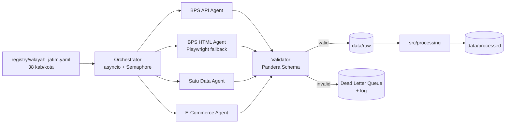
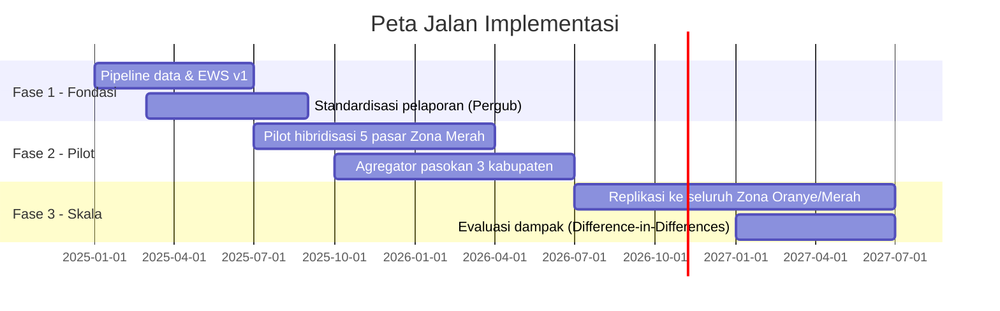

# Evaluasi Risiko Kebangkrutan dan Penyusutan Pembeli Pasar Tradisional di Jawa Timur (2014–2024)

**Dokumen Spesifikasi Teknis & Bisnis** · Versi 1.0 · Status: Draf Arsitektur

---

## Tugas 1 — Struktur File & Repositori

```text
analisis-tren-pasartradisional/
├── .github/
│   └── workflows/
│       ├── ci.yml                     # Lint (ruff), type-check (mypy), pytest
│       └── scheduled_scrape.yml       # Cron bulanan: refresh data BPS
├── agents/                            # Agen pengumpul data (multi-agent)
│   ├── __init__.py
│   ├── orchestrator.py                # Koordinator asinkron (asyncio + semaphore)
│   ├── base_agent.py                  # Kelas abstrak: fetch → parse → validate → emit
│   ├── bps_api_agent.py               # Jalur utama: BPS WebAPI (webapi.bps.go.id)
│   ├── bps_html_agent.py              # Fallback: scraping HTML tabel dinamis BPS kab/kota
│   ├── satudata_agent.py              # Portal Satu Data Jatim / Open Data Pemda
│   ├── ecommerce_agent.py             # Statistik E-Commerce BPS, Google Trends
│   ├── registry/
│   │   └── wilayah_jatim.yaml         # 38 kab/kota: kode BPS, subdomain, kode var
│   └── utils/
│       ├── rate_limiter.py
│       ├── retry.py                   # Exponential backoff + jitter
│       └── user_agent.py
├── config/
│   ├── settings.yaml                  # Parameter global (rentang tahun, path, timeout)
│   ├── indicators.yaml                # Kamus indikator & mapping variabel BPS
│   └── logging.yaml
├── data/
│   ├── raw/                           # Data mentah immutable (tidak di-commit)
│   │   ├── bps/{kode_wilayah}/{tahun}/
│   │   ├── satudata/
│   │   └── ecommerce/
│   ├── interim/                       # Hasil parsing & harmonisasi awal
│   ├── processed/                     # Panel final siap model (Parquet)
│   │   ├── panel_pasar_jatim.parquet
│   │   └── risk_scores.parquet
│   ├── external/
│   │   └── geo/jatim_kabkota.geojson  # Batas administrasi 38 kab/kota
│   └── README.md                      # Data dictionary & lineage
├── notebooks/
│   ├── 01_eda_panel_pasar.ipynb
│   ├── 02_data_quality_audit.ipynb
│   ├── 03_its_covid_intervention.ipynb
│   ├── 04_forecast_prophet_sarimax.ipynb
│   ├── 05_spatial_autocorrelation.ipynb
│   ├── 06_survival_risk_model.ipynb
│   └── 07_model_comparison.ipynb
├── src/
│   ├── __init__.py
│   ├── ingestion/
│   │   ├── loaders.py                 # Raw → DataFrame terstandar
│   │   └── schemas.py                 # Pandera schema validasi
│   ├── processing/
│   │   ├── cleaning.py
│   │   ├── harmonization.py           # Penyelarasan kode wilayah & definisi antar-tahun
│   │   ├── imputation.py              # Interpolasi & imputasi berbasis panel
│   │   └── feature_engineering.py     # Rasio, laju, lag, indeks komposit
│   ├── models/
│   │   ├── intervention.py            # Interrupted Time Series (COVID shock)
│   │   ├── forecasting.py             # Prophet / SARIMAX / hierarchical
│   │   ├── spatial.py                 # Moran's I, LISA, GWR
│   │   ├── survival.py                # Cox PH / Random Survival Forest
│   │   └── risk_index.py              # Market Distress Index (MDI)
│   ├── evaluation/
│   │   ├── metrics.py                 # MAPE, sMAPE, MASE, C-index
│   │   └── backtesting.py             # Rolling-origin cross-validation
│   ├── pipeline/
│   │   ├── run_etl.py
│   │   └── run_models.py
│   └── utils/
│       ├── io.py
│       └── geo.py
├── app/
│   ├── Home.py                        # Entry point Streamlit
│   ├── pages/
│   │   ├── 1_🗺️_Peta_Risiko.py
│   │   ├── 2_📈_Tren_Time_Series.py
│   │   ├── 3_🦠_Dampak_COVID.py
│   │   ├── 4_🛒_Ecommerce_vs_Pasar.py
│   │   └── 5_🔮_Proyeksi_2029.py
│   ├── components/
│   │   ├── sidebar.py
│   │   ├── kpi_cards.py
│   │   ├── choropleth.py
│   │   └── charts.py
│   ├── assets/
│   │   └── style.css
│   └── .streamlit/
│       └── config.toml                # Tema & konfigurasi server
├── tests/
│   ├── test_agents.py
│   ├── test_processing.py
│   └── test_models.py
├── docs/
│   ├── SPESIFIKASI_TEKNIS.md          # Dokumen ini
│   ├── metodologi.md
│   └── arsitektur.png
├── reports/
│   └── figures/
├── .env.example                       # BPS_API_KEY=, dsb.
├── .gitignore
├── .pre-commit-config.yaml
├── Makefile                           # make scrape | etl | model | app
├── pyproject.toml
├── requirements.txt
├── LICENSE
└── README.md
```

**Ketentuan `.gitignore` minimum:** `data/raw/`, `data/interim/`, `*.parquet` (kecuali sampel), `.env`, `__pycache__/`, `.ipynb_checkpoints/`, `.venv/`, `mlruns/`.

**Inti `requirements.txt`:**

```text
# Ingestion
httpx>=0.27
aiohttp>=3.9
selectolax>=0.3
playwright>=1.44
tenacity>=8.2
pyyaml>=6.0
python-dotenv>=1.0
# Processing
pandas>=2.2
polars>=0.20
pyarrow>=16.0
pandera>=0.19
# Modeling
statsmodels>=0.14
prophet>=1.1
pmdarima>=2.0
scikit-learn>=1.4
lifelines>=0.28
scikit-survival>=0.22
# Spatial
geopandas>=0.14
libpysal>=4.10
esda>=2.5
mgwr>=2.2
# App & Viz
streamlit>=1.35
plotly>=5.22
pydeck>=0.9
# Dev
pytest>=8.0
ruff>=0.4
mypy>=1.10
```

---

## Tugas 2 — Latar Belakang & Permasalahan Bisnis

### 2.1 Latar Belakang

Dalam satu dekade terakhir, pola belanja rumah tangga di Jawa Timur bergeser secara struktural. Penetrasi minimarket berjaringan hingga ke tingkat kecamatan, meluasnya akses internet seluler, dan normalisasi pembayaran digital (QRIS, dompet elektronik) memindahkan sebagian belanja kebutuhan harian dari pasar rakyat ke kanal yang menawarkan kepastian harga, kenyamanan, dan jam operasional panjang. Pasar tradisional, yang secara historis menjadi simpul distribusi pangan dan barang konsumsi bagi 38 kabupaten/kota, menghadapi erosi basis pembeli yang berjalan perlahan namun konsisten, terutama pada segmen konsumen usia produktif di kawasan perkotaan.

Pandemi COVID-19 pada 2020–2021 berfungsi sebagai akselerator guncangan. Kebijakan PSBB dan PPKM membatasi jam operasional dan kapasitas pasar, sejumlah pasar ditutup sementara akibat klaster penularan, dan daya beli masyarakat tertekan. Di saat yang sama, konsumen yang terpaksa beralih ke belanja daring membentuk kebiasaan baru yang tidak sepenuhnya kembali setelah pembatasan dicabut. Pertanyaan krusialnya bukan hanya seberapa dalam penurunan aktivitas pasar saat pandemi, melainkan apakah pemulihan pasca-2021 kembali ke lintasan semula atau justru membentuk *level shift* permanen yang lebih rendah.

Pasca-pandemi, disrupsi memasuki fase berikutnya: *live commerce* dan *social commerce*. Platform video pendek dengan fitur belanja langsung memungkinkan penjual menjangkau pembeli lintas kota dengan harga agresif, termasuk untuk komoditas yang sebelumnya menjadi domain pasar rakyat seperti pakaian, perlengkapan rumah tangga, dan produk olahan. Kombinasi ritel modern di sisi fisik dan *live commerce* di sisi digital menciptakan tekanan dua arah yang belum pernah dihadapi pedagang pasar sebelumnya.

### 2.2 Permasalahan Bisnis

Penyusutan pasar tradisional berdampak langsung pada perekonomian daerah. Lapangan usaha Perdagangan Besar dan Eceran (Kategori G) merupakan salah satu kontributor terbesar PDRB Jawa Timur, dan pasar rakyat adalah tempat kegiatan ini paling banyak menyerap tenaga kerja informal. Ketika pasar kehilangan pembeli, efeknya berantai: omzet pedagang turun, kios ditinggalkan, retribusi pasar sebagai komponen Pendapatan Asli Daerah (PAD) menyusut, dan petani serta UMKM pemasok kehilangan saluran distribusi utama. Distribusi nilai tambah pun bergeser dari pelaku lokal ke korporasi ritel dan platform digital yang margin keuntungannya sebagian besar tidak berputar di daerah.

Dari sisi sosial, pedagang pasar didominasi pelaku usaha mikro dengan modal kecil, literasi digital terbatas, dan akses pembiayaan formal yang minim. Mereka adalah kelompok yang paling lambat beradaptasi dan paling rentan terhadap kebangkrutan diam-diam: kios tidak dibuka lagi, tetapi tidak pernah tercatat sebagai penutupan usaha. Hilangnya mata pencaharian ini sering tidak tertangkap statistik resmi hingga dampaknya sudah meluas, misalnya dalam bentuk kenaikan pengangguran terbuka atau pergeseran ke sektor informal yang lebih rentan.

Masalah intinya adalah **ketiadaan sistem peringatan dini (*early warning system*) berbasis data yang terpusat.** Data pasar tersebar di 38 situs BPS kabupaten/kota, dinas perdagangan, dan badan pendapatan daerah dengan format, granularitas, dan definisi yang tidak seragam. Tidak ada indikator komposit yang secara rutin memetakan pasar atau wilayah mana yang sedang menuju fase distress. Akibatnya, intervensi pemerintah (revitalisasi fisik, bantuan modal) cenderung reaktif, berbasis usulan politis, dan tidak terukur dampaknya. Proyek ini menutup celah tersebut dengan mengintegrasikan data lintas sumber menjadi satu panel analitik dan indeks risiko yang dapat dipantau.

---

## Tugas 3 — Tujuan & Metode Pendekatan

### 3.1 Tujuan Analitik

| # | Output | Deliverable Terukur |
|---|--------|---------------------|
| T1 | **Panel data terpadu** | Dataset panel 38 kab/kota × 11 tahun (2014–2024), ≥ 15 indikator, tervalidasi skema, dengan *data lineage* terdokumentasi |
| T2 | **Kuantifikasi guncangan COVID-19** | Estimasi besaran penurunan (*shock magnitude*) dan *recovery rate* per kab/kota, dengan interval kepercayaan |
| T3 | **Market Distress Index (MDI)** | Skor risiko 0–100 per kab/kota per tahun, terklasifikasi Hijau / Kuning / Oranye / **Merah** |
| T4 | **Peta zona merah** | Identifikasi klaster spasial wilayah berisiko tinggi (*High-High cluster* LISA) |
| T5 | **Proyeksi 5 tahun (2025–2029)** | Forecast jumlah pasar aktif, jumlah pedagang, dan proksi omzet dengan *prediction interval* 80% & 95% |
| T6 | **Driver analysis** | Peringkat faktor penentu penyusutan (kepadatan minimarket, penetrasi internet, PDRB per kapita, dsb.) |
| T7 | **Dashboard Streamlit** | Aplikasi interaktif yang ter-*deploy* dan diperbarui otomatis via pipeline terjadwal |

### 3.2 Metode Pengumpulan Data — Arsitektur Multi-Agen Asinkron

**Prinsip desain:** *API-first, scraping as fallback.* BPS menyediakan WebAPI resmi; scraping HTML hanya digunakan untuk tabel yang tidak terekspos API.



- **Orchestrator:** Mengelola 38 tugas wilayah × N indikator secara konkuren menggunakan `asyncio.gather` dengan `Semaphore` (maks. 5–8 koneksi simultan) untuk menghormati beban server pemerintah.
- **Agen spesialis:** Setiap agen mewarisi `BaseAgent` dengan siklus `fetch → parse → validate → emit`. Kegagalan satu agen/wilayah tidak menghentikan pipeline (*fault isolation*).
- **Ketahanan:** Retry *exponential backoff* dengan jitter (`tenacity`), timeout per permintaan, *checkpointing* agar eksekusi dapat dilanjutkan dari titik gagal.
- **Idempotensi:** Data mentah disimpan dengan pola `raw/{sumber}/{kode_wilayah}/{tahun}/` beserta hash konten; pengambilan ulang hanya dilakukan bila hash berubah.
- **Kepatuhan:** Mematuhi `robots.txt`, menyertakan User-Agent identifikatif, dan membatasi laju permintaan.

**Indikator target dan sumber:**

| Kelompok | Indikator | Sumber |
|----------|-----------|--------|
| Infrastruktur pasar | Jumlah pasar tradisional, jumlah kios/los/lapak, pasar dengan bangunan permanen | BPS (Profil Pasar, Kab/Kota Dalam Angka), Disperindag |
| Aktivitas | Jumlah pedagang aktif, tingkat hunian kios, realisasi retribusi pasar | Disperindag, Bapenda/LKPD (PAD) |
| Makroekonomi | PDRB Kategori G (ADHK & ADHB), PDRB per kapita, inflasi | BPS |
| Kompetitor fisik | Jumlah minimarket/supermarket, toko modern per 10.000 penduduk | BPS, Podes, Disperindag |
| Digital | Penetrasi internet RT, usaha e-commerce, indeks pencarian belanja daring | BPS (Statistik E-Commerce, Susenas), Google Trends |
| Demografi | Penduduk, kepadatan, rasio urbanisasi, struktur umur | BPS |

> **Catatan Kualitas Data (Kritis):** Data omzet per pasar hampir tidak tersedia secara publik. Omzet akan diestimasi melalui **proksi** (retribusi pasar, PDRB Kategori G, tingkat hunian kios). Selain itu, beberapa indikator BPS bersumber dari survei/sensus berkala (mis. Podes setiap ±3 tahun), sehingga diperlukan interpolasi terkontrol dan penandaan nilai imputasi (`is_imputed`) di setiap baris.

### 3.3 Metode Analisis & Pemodelan

**Tantangan fundamental:** Data tahunan 2014–2024 hanya menghasilkan **11 observasi per kab/kota**, terlalu pendek untuk model time-series univariat yang andal. Strategi pemodelan karena itu memanfaatkan **struktur panel** (38 × 11 = 418 observasi) dan, jika tersedia, data bulanan/kuartalan (retribusi, harga, Google Trends).

**A. Kuantifikasi guncangan COVID-19 — Interrupted Time Series (ITS)**

```text
Y_it = β0 + β1·t + β2·COVID_t + β3·(t − 2020)·POST_t + α_i + ε_it
```

- `β2` = *level shift* (besaran anjlokan saat guncangan).
- `β3` = perubahan kemiringan pasca-intervensi; `β3 > 0` mengindikasikan pemulihan.
- **Recovery Rate (RR):** `RR_i = (Y_i,2024 − Y_i,trough) / (Ŷ_i,2024|counterfactual − Y_i,trough)`, di mana kontrafaktual = proyeksi tren pra-2020. RR ≥ 1 berarti pulih penuh; RR < 0,5 masuk kategori *scarring* permanen.
- Model fixed-effects panel (`linearmodels`/`statsmodels`) dengan *clustered standard errors* per kab/kota.

**B. Forecasting 2025–2029**

| Model | Peran | Konfigurasi Kunci |
|-------|-------|-------------------|
| **SARIMAX** | Baseline statistik | Variabel eksogen (penetrasi internet, kepadatan minimarket) + dummy intervensi 2020–2021 |
| **Prophet** | Model utama untuk seri bulanan | `changepoints` manual di 2020-03 dan 2022-01, `holidays` untuk Ramadan/Idulfitri, regressor eksternal |
| **Hierarchical / Global Model** | Mengatasi seri pendek | Pooling lintas 38 wilayah (mis. LightGBM global dengan fitur lag atau Bayesian hierarchical), rekonsiliasi Kab/Kota → Provinsi |
| **Ensemble** | Output final | Rata-rata tertimbang berdasarkan inverse-MASE hasil backtesting |

- **Validasi:** *Rolling-origin backtesting* (train s.d. 2019 → uji 2020–2021 untuk menguji ketahanan terhadap guncangan; train s.d. 2021 → uji 2022–2024).
- **Metrik:** MASE (utama, karena skala antarwilayah berbeda), sMAPE, dan *coverage* prediction interval.
- **Skenario:** Proyeksi disajikan dalam tiga skenario (*baseline*, *akselerasi digital*, *intervensi kebijakan*).

**C. Analisis Korelasi Spasial**

- **Global Moran's I** untuk menguji apakah laju penyusutan pasar terklaster secara geografis (bobot spasial *Queen contiguity*).
- **LISA (Local Moran's I)** untuk memetakan klaster *High-High* (zona merah), *Low-Low*, serta *outlier* spasial.
- **Geographically Weighted Regression (GWR/MGWR)** untuk mengukur apakah pengaruh e-commerce dan ritel modern terhadap penyusutan berbeda antara kawasan Gerbangkertosusila, Tapal Kuda, Mataraman, dan Madura.

**D. Market Distress Index (MDI) & Model Risiko**

- **MDI** = indeks komposit dari komponen ternormalisasi (min-max atau z-score), dengan bobot ditentukan melalui PCA dan divalidasi oleh *expert judgment*:
  - Laju perubahan jumlah pedagang aktif (↓)
  - Tingkat kekosongan kios (↑)
  - Pertumbuhan retribusi riil (↓)
  - Kepadatan ritel modern per kapita (↑)
  - Recovery Rate pasca-COVID (↓)
  - Penetrasi belanja daring (↑)
- **Klasifikasi:** 0–25 Hijau · 26–50 Kuning · 51–75 Oranye · **76–100 Merah**.
- **Survival Analysis (opsional, bila data tingkat pasar tersedia):** Cox Proportional Hazards / Random Survival Forest untuk mengestimasi *hazard* penutupan pasar, dievaluasi dengan C-index.
- **Interpretabilitas:** SHAP values untuk menjelaskan kontribusi tiap faktor terhadap skor risiko per wilayah.

---

## Tugas 4 — Rancangan Visualisasi (Streamlit) & Ekspektasi Insight

### 4.1 Komponen Sidebar (Filter Global)

| Kontrol | Widget | Perilaku |
|---------|--------|----------|
| **Rentang Tahun** | `st.slider` (2014–2024, rentang) | Default 2014–2024; tombol cepat "Pra-COVID", "COVID", "Pasca-COVID" |
| **Kabupaten/Kota** | `st.multiselect` | Opsi "Semua Jatim"; grup cepat per wilayah budaya (Gerbangkertosusila, Tapal Kuda, Mataraman, Madura) |
| **Jenis Wilayah** | `st.radio` | Semua / Kabupaten / Kota |
| **Metrik Utama** | `st.selectbox` | Jumlah pasar, jumlah pedagang, kepadatan lapak per 10.000 penduduk, laju penutupan (%), MDI, Recovery Rate |
| **Mode Nilai** | `st.toggle` | Absolut vs. pertumbuhan YoY (%) |
| **Skenario Proyeksi** | `st.selectbox` | Baseline / Akselerasi Digital / Intervensi Kebijakan |
| **Unduh Data** | `st.download_button` | Ekspor CSV hasil filter |

State filter disimpan di `st.session_state` dan disinkronkan ke URL (`st.query_params`) agar tampilan dapat dibagikan.

### 4.2 Halaman & Elemen Visual

**Header KPI (seluruh halaman)** — 4 kartu `st.metric` dengan delta terhadap tahun pembanding:
Total pasar aktif · Total pedagang aktif · Rata-rata MDI Jatim · Jumlah kab/kota Zona Merah.

**A. Peta Choropleth Jawa Timur** (`plotly.choropleth_mapbox` + GeoJSON 38 kab/kota)
- Warna berdasarkan metrik terpilih; skala sekuensial untuk kepadatan, skala divergen (merah–hijau) untuk laju pertumbuhan.
- **Slider animasi tahun** (2014→2024) untuk memperlihatkan "rambatan" zona merah dari waktu ke waktu.
- Tooltip: nama wilayah, nilai metrik, peringkat provinsi, kategori MDI, recovery rate.
- *Layer toggle:* overlay klaster LISA (High-High ditandai garis tepi tebal).
- Klik wilayah → *drill-down* ke halaman profil kab/kota.

**B. Time-Series: E-Commerce vs. Lapak Fisik**
- **Grafik dual-axis** (`plotly.graph_objects`): sumbu kiri = jumlah lapak/pedagang aktif (garis), sumbu kanan = indeks penetrasi e-commerce/penetrasi internet (area).
- **Shading vertikal** periode PSBB/PPKM (2020-03 s.d. 2021-12) dan anotasi peristiwa penting (mis. lonjakan *live commerce*).
- **Garis kontrafaktual** (proyeksi tren pra-COVID, putus-putus) untuk memvisualisasikan *gap* akibat guncangan.
- **Indexed chart (2014 = 100)** agar beberapa kab/kota dapat dibandingkan dalam satu kanvas.

**C. Analisis Dampak COVID**
- **Slope chart** 2019 → 2021 → 2024 per kab/kota (penurunan & pemulihan).
- **Scatter plot** *Shock Magnitude* (sumbu-x) vs. *Recovery Rate* (sumbu-y), membagi wilayah ke 4 kuadran: *Resilient*, *Recovered*, *Fragile*, *Scarred*.

**D. Driver & Korelasi**
- **Scatter + regresi** PDRB Kategori G vs. laju penutupan pasar, ukuran titik = jumlah penduduk.
- **Heatmap korelasi** antarindikator.
- **SHAP bar chart** kontribusi faktor terhadap MDI wilayah terpilih.

**E. Proyeksi 2029**
- Fan chart forecast dengan *prediction interval* 80% & 95%.
- Tabel peringkat "10 Kab/Kota Berisiko Tertinggi 2029" dengan `st.dataframe` + *conditional formatting*.

### 4.3 Ekspektasi Insight (Hipotesis Utama)

| # | Hipotesis | Cara Pengujian di Dashboard |
|---|-----------|----------------------------|
| **H1 — Paradoks Pertumbuhan** | Kab/kota dengan pertumbuhan PDRB Kategori G tertinggi (mis. kawasan Gerbangkertosusila) justru mengalami laju penyusutan pasar tradisional tercepat, karena pertumbuhan sektor perdagangan didorong ritel modern dan platform digital, bukan pasar rakyat. | Scatter PDRB G vs. laju penutupan; koefisien GWR positif di wilayah perkotaan |
| **H2 — Bekas Luka Permanen (*Scarring*)** | Guncangan COVID-19 menciptakan *level shift* permanen: mayoritas kab/kota perkotaan memiliki Recovery Rate < 1 hingga 2024, sementara kabupaten agraris (Mataraman, Madura) pulih lebih cepat karena pasar masih menjadi simpul distribusi hasil tani. | Kuadran Shock vs. Recovery; garis kontrafaktual ITS |
| **H3 — Kontagion Spasial** | Distress pasar terklaster secara geografis (Moran's I signifikan positif) dan merambat mengikuti koridor infrastruktur/jalan tol, yaitu wilayah yang bertetangga dengan pusat ritel modern lebih cepat kehilangan pembeli. | Animasi choropleth + overlay klaster LISA High-High |

*Hipotesis sekunder:* elastisitas penurunan jumlah pedagang terhadap kenaikan penetrasi internet meningkat tajam setelah 2022, menandakan pergeseran kompetisi dari ritel modern ke *live commerce*.

---

## Tugas 5 — Solusi dan Rekomendasi Masa Depan

Rekomendasi disusun berdasarkan kategori MDI agar alokasi anggaran berbasis risiko, bukan merata.

### 5.1 Matriks Intervensi Berbasis Zona Risiko

| Zona MDI | Strategi | Fokus |
|----------|----------|-------|
| 🟢 Hijau | **Preservasi** | Pemeliharaan, pemantauan rutin |
| 🟡 Kuning | **Penguatan** | Digitalisasi pembayaran, pelatihan pedagang |
| 🟠 Oranye | **Hibridisasi** | Integrasi kanal daring-luring, perbaikan rantai pasok |
| 🔴 Merah | **Transformasi / Konsolidasi** | Revitalisasi fungsi, *merger* pasar, alih fungsi parsial |

### 5.2 Rekomendasi Strategis

**1. Digitalisasi Rantai Pasok Pasar (Sisi Hulu)**
- Membangun **agregator pasokan tingkat kabupaten** yang menghubungkan petani/pemasok langsung ke pedagang pasar untuk memangkas rantai perantara dan menurunkan harga pokok sehingga pasar kompetitif secara harga terhadap ritel modern.
- Mengintegrasikan data harga harian pasar ke sistem pemantauan harga yang sudah ada agar transparansi harga menjadi nilai jual pasar.
- **KPI:** Penurunan selisih harga pasar vs. ritel modern untuk komoditas utama; penurunan biaya logistik pedagang.

**2. Hibridisasi Model Bisnis Pedagang (Sisi Hilir)**
- **"Pasar Rakyat Live":** Program pendampingan *live selling* kolektif per pasar (studio bersama di kantor pengelola pasar), dengan kurasi produk khas lokal agar pedagang tidak bersaing langsung dalam perang harga.
- **Layanan pesan-antar berbasis pasar** melalui kemitraan dengan ojek daring atau koperasi kurir lokal (pemesanan via WhatsApp Business/katalog terpadu), dengan target segmen rumah tangga dan pelaku kuliner (B2B).
- Adopsi QRIS 100% sebagai prasyarat program, sekaligus menciptakan jejak transaksi digital yang menjadi dasar *credit scoring* untuk akses KUR.
- **KPI:** Persentase pedagang dengan kanal penjualan daring; porsi omzet dari kanal digital.

**3. Revitalisasi Tata Ruang & Fungsi Pasar**
- Mengubah orientasi revitalisasi dari **pembangunan fisik** menjadi **revitalisasi fungsi**: pasar sebagai ruang publik dengan zona kuliner, area komunitas, *night market*, dan atraksi wisata belanja untuk menarik konsumen usia muda.
- **Konsolidasi pasar** di Zona Merah dengan tingkat kekosongan kios tinggi: menggabungkan pasar yang berdekatan dan mengalihkan fungsi aset yang tidak produktif (gudang distribusi, *dark store* bersama, pusat UMKM) agar tetap menghasilkan PAD.
- **Regulasi zonasi ritel modern** yang ditegakkan secara konsisten (jarak minimum dari pasar rakyat, kewajiban kemitraan pemasok lokal), dengan evaluasi berbasis data MDI, bukan sekadar perizinan administratif.

**4. Instrumen Fiskal & Pembiayaan**
- **Retribusi progresif berbasis kinerja:** keringanan retribusi di pasar Zona Oranye/Merah selama masa transisi untuk mencegah eksodus pedagang.
- **Skema pembiayaan mikro bersubsidi** melalui Bank Daerah (Bank Jatim/BPR) dengan agunan berbasis riwayat transaksi QRIS.
- **Asuransi usaha mikro** untuk pedagang guna memitigasi guncangan sistemik di masa depan (pandemi, bencana).

**5. Institusionalisasi Early Warning System**
- Mengadopsi dashboard proyek ini sebagai **instrumen resmi Disperindag Jatim**, dengan *pipeline* pembaruan data otomatis dan pelaporan MDI kuartalan kepada kepala daerah.
- **Standardisasi pelaporan data pasar** dari 38 kab/kota (format, frekuensi bulanan, definisi pedagang aktif) melalui Peraturan Gubernur, sehingga kualitas input EWS meningkat dan ketergantungan pada proksi berkurang.
- **Mekanisme pemicu (*trigger*):** wilayah yang naik ke Zona Merah otomatis memicu kajian lapangan dan penyusunan rencana aksi dalam 90 hari.

### 5.3 Peta Jalan Implementasi



> **Prinsip evaluasi:** Setiap intervensi dirancang dengan kelompok pembanding (pasar pilot vs. non-pilot dengan MDI setara) sehingga dampaknya dapat diukur secara kausal melalui *Difference-in-Differences*, bukan sekadar klaim keberhasilan administratif.
